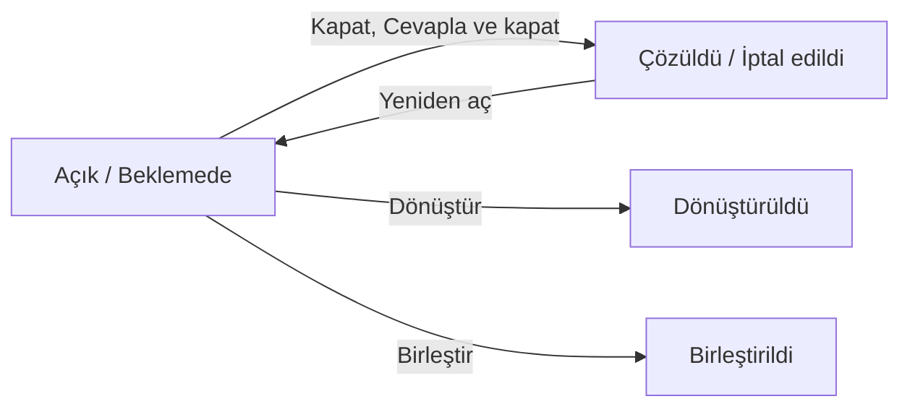

Çağrı, bir kullanıcının destek ekibine ulaştığı ilk kayıttır. E-postayla gelir ya da telefonla arayan veya masaya gelen kullanıcı için teknisyen tarafından açılır. Her çağrı değerlendirilir. Sonra ya yanıtlanıp kapatılır ya da olay, istek veya sürekli iyileştirme kaydına dönüştürülerek ilgili süreçte ele alınır.

<Callout type="info" title="ÖNEMLİ">Bu bölüm ServiceCore'un yeni çağrı arayüzünü anlatır. Mevcut ekranlar için bkz. [Çağrı](/docs/teknisyen/moduller/cagrilar).</Callout>

## Ekranın bölümleri

| # | Bölüm | Ne işe yarar |
|---|---|---|
| ❶ | Kenar çubuğu | `Çağrılar` bölümü. |
| ❷ | `Ürünler` | ProjectCore, AssetCore ve ServiceCore arasında geçiş yapar. |
| ❸ | Görünüm sekmeleri | Hazır ve kayıtlı görünümler. Bkz. [Çağrı Listesi](/docs/teknisyen/moduller/cagrilar-v2/liste). |
| ❹ | **Çağrı oluştur** | Yeni çağrı formunu açar. Bkz. [Çağrı Oluşturma](/docs/teknisyen/moduller/cagrilar-v2/olusturma). |
| ❺ | `Filtrele` | Süzgeç alanlarını açar. |

Listede bir çağrıya basınca çağrı, listenin sağında bir panelde açılır. Bkz. [Çağrı Paneli](/docs/teknisyen/moduller/cagrilar-v2/detay).

## Durumlar ve aşamalar

Her durum üç aşamadan birine aittir:

| Aşama | Durumlar |
|---|---|
| `Açık` | `Yeni`, `İnceleniyor` |
| `Beklemede` | **Kullanıcı yanıtı bekleniyor**, **Üçüncü taraf bekleniyor** |
| `Kapalı` | `Çözüldü`, `Dönüştürüldü`, `Birleştirildi`, **İptal edildi** |

Durum etiketinin üzerine gelince aşaması da görünür.

## Çağrının sonuçları

| Sonuç | Ne olur |
|---|---|
| Kapatma | Kapatma durumu ve yorumuyla kapanır; yeniden açılabilir. Bkz. [Kapatma ve Cevaplama](/docs/teknisyen/moduller/cagrilar-v2/kapatma-ve-cevaplama). |
| Dönüştürme | Çağrıdan bir olay, istek ya da sürekli iyileştirme kaydı açılır. Çağrı `Dönüştürüldü` olur ve bir daha değiştirilemez. |
| Birleştirme | Aynı konudaki çağrılar tek çağrıda toplanır. Öbürleri `Birleştirildi` olur ve yazışma hedef çağrıda sürer. |

Dönüştürme ve birleştirme için bkz. [Dönüştürme ve Birleştirme](/docs/teknisyen/moduller/cagrilar-v2/donusturme-ve-birlestirme). Şemada silme gösterilmemiştir; silinen çağrı `Geri al` ile hemen geri getirilebilir.

## Yetkiler

Çağrının hâline uymayan bir işlem hiç görünmez. Örneğin kapalı çağrıda `Kapat` yoktur, onun yerine `Yeniden aç` görünür. Hâline uyan ama yetkiniz olmayan işlem ise satır menüsünde pasif görünür ve altında nedeni yazar, ör. `Bu çağrıyı kapatma yetkiniz yok.`
