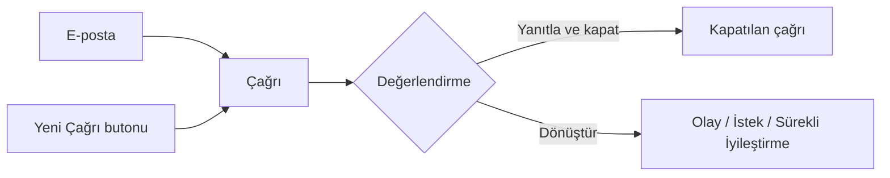

Çağrı, kullanıcıdan gelen ve henüz bir sürece bağlanmamış mesajın ServiceCore'daki ilk
kaydıdır. Her çağrı bir teknisyen tarafından değerlendirilir; ya yanıtlanarak kapatılır ya da
olay, istek veya sürekli iyileştirme kaydına dönüştürülür.

## E-postayla gelen çağrı

Uygulamaya tanımlı e-posta adreslerine gelen her mesaj otomatik olarak çağrıya dönüşür.
E-postanın bilgileri çağrının alanlarına aktarılır:

| # | Alan | E-postadan gelen bilgi |
|---|---|---|
| ❶ | `Çağrı Konusu` | E-postanın konusu |
| ❷ | `Çağrı Açıklaması` | E-postanın içeriği |
| ❸ | `Kullanıcı` | E-postayı gönderen kişi. Gönderen adres uygulamadaki bir kullanıcıya aitse alan kendiliğinden dolar |
| ❹ | `Kaynak` | `E-Mail` |
| ❺ | E-posta adresleri | Gönderen (`From`), alıcı (`To`) ve bilgi (`Cc`) adresleri |

E-postanın ekleri çağrının eklerine eklenir. Çağrı açıkken kullanıcının aynı e-postaya
verdiği yanıt yeni bir çağrı açmaz, çağrının yazışmalarına eklenir.

<Callout type="info" title="ÖNEMLİ">
Hangi e-posta adreslerine gelen mesajların çağrıya dönüşeceğini yöneticiniz
`Sistem Ayarları` altındaki **E-Posta Yakalayıcısı** bölümünde belirler. Ayrıntılar için
[Sistem Ayarları](/docs/admin-egitimleri/genel-panel-ayarlari/sistemayarlari) sayfasına bakın.
</Callout>

## Telefonla ya da yüz yüze gelen talep

Telefonla ya da yüz yüze iletilen talepler çağrı listesinin sağ üstündeki `Yeni Çağrı` ❶
butonuyla kaydedilir. Ayrıntılar için [Yeni Çağrı Ekleme](/docs/teknisyen/moduller/cagrilar/yeni-cagri)
sayfasına bakın.

## Çağrıyı sonuçlandırma

Teknisyen çağrının kartına tıklayarak detayını açar, eksik bilgileri tamamlar ve kartın
sağındaki butonlardan biriyle çağrıyı sonuçlandırır:

| # | Buton | Sonuç |
|---|---|---|
| ❶ | `Olay` | Çağrıdan olay kaydı açılır |
| ❷ | `İstek` | Çağrıdan hizmet katalogundaki bir istek açılır |
| ❸ | `Sürekli iyileştirme` | Çağrıdan sürekli iyileştirme kaydı açılır |
| ❹ | `Cevapla ve Kapat` | Kullanıcıya e-posta ile cevap gider, çağrı kapanır |
| ❺ | `Kapat` | Çağrı bir kapanış açıklamasıyla kapanır |
| ❻ | `Sil` | Çağrı bir silme gerekçesiyle silinir |

Dönüştürmede çağrının konusu, açıklaması, ekleri ve e-posta yazışmaları oluşan kayda
aktarılır. Birden fazla çağrıyı tek seferde kapatmak, birleştirmek ya da dönüştürmek için
[Toplu İşlemler](/docs/teknisyen/moduller/cagrilar/toplu-islemler) sayfasına bakın.

## Sonuçlanan çağrılar

Kapatılan ve dönüştürülen çağrılar açık çağrılar listesinden çıkar. Bu çağrıları görmek için
`Kontrol Paneli`'nde `Aşama` alanından `Kapalı` seçin. Kartın durum etiketi çağrının nasıl
sonuçlandığını gösterir:

| # | Durum | Anlamı |
|---|---|---|
| ❶ | `İsteğe Dönüştürülenler` | Çağrıdan istek açıldı; isteğin numarası (`#SR`) `Dönüştürüldü` alanında görünür |
| ❷ | `İyileştirmeye Dönüştürülenler` | Çağrıdan sürekli iyileştirme kaydı açıldı (`#CI`) |
| ❸ | `Olaya Dönüştürülenler` | Çağrıdan olay kaydı açıldı (`#INC`) |
| ❹ | `Kapatılanlar` | Çağrı dönüştürülmeden kapatıldı |

`Dönüştürüldü` alanındaki numaraya tıkladığınızda oluşan kayıt yeni bir sekmede açılır.
