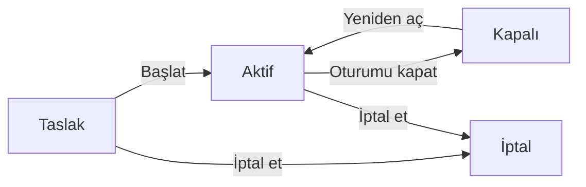

Sayım, belirli bir kapsamdaki varlıkların fiziksel olarak okutulup kayıtla karşılaştırılmasıdır. Her sayım bir **oturum** olarak yürütülür.

## Oturum listesi

| # | Öğe | Ne işe yarar |
|---|---|---|
| ❶ | **Oturum oluştur** | Yeni sayım oturumu açar (aşağıda). |
| ❷ | `Durum` | Oturumları duruma göre süzer. |

Tabloda her oturumun ilerlemesi (sayılan / beklenen), başlangıç, kapanış ve başlatan kişi görünür. `Kapsamsız` etiketi, oturumun bir kapsamla sınırlanmadığını gösterir. Satır ⋯ menüsünde **Sayım raporunu aç** ile oturumun durumuna göre `Başlat`, **Oturumu kapat**, `Yeniden aç`, `İptal et` ve `Sil` bulunur.

## Oturum oluşturma

`Ad` zorunludur. `Kapsam` bölümünde tür, arama ve süzgeçle hangi varlıkların bekleneceği belirlenir. Varlık listesindeki `Sayım başlat` düğmesi bu pencereyi, listenin o anki süzgeciyle dolu olarak açar.

Pencerenin altında iki seçenek vardır: **Taslak olarak kaydet** oturumu başlatmadan saklar, birincil düğme ise oturumu oluşturup hemen başlatır.

## Oturum sayfası

| # | Öğe | Ne işe yarar |
|---|---|---|
| ❶ | Durum geçişi | Oturumun durumuna göre sıradaki işlem, ör. aktif oturumda **Oturumu kapat**. Öbür işlemler ⋯ menüsündedir. |
| ❷ | `Okutun` | El okuyucuyla okutun ya da barkodu, Varlık No'yu, varlık etiketini veya seri no'yu yazıp `Enter`'a basın. |
| ❸ | Sekmeler | `Beklenen`, `Fazla`, `Kayıtlar`, `Ayrıntılar`, `Aktivite`. |

Üstteki kareler beklenen, sayılan, kayıp ve fazla sayılarını gösterir. Okutulan kod şu sonuçlardan birini verir:
- `Sayıldı`
- **Zaten sayılmıştı**
- **Kapsam dışında**: kodu tanınan ama beklenen listede olmayan varlık. `Fazla` sekmesine yazılır.
- `Tanınmadı`: hiçbir varlıkla eşleşmeyen kod. Bu da `Fazla` sekmesine yazılır.
- **Birden çok varlık**

`Beklenen` sekmesinde satırları seçip **Sayıldı işaretle** ya da **Kayıp işaretle** ile okutmadan da işaretleyebilirsiniz. Her satırın sonucu, nitelikleri (`Sağlam`, `Hasarlı`, **Eksik parça**, `Etiketsiz`) ve notu yerinde düzenlenir. Her işaret anında kaydedilir.

## Oturumun yaşam döngüsü

| Geçiş | Sonucu |
|---|---|
| `Başlat` | Beklenen liste o anki kapsama göre dondurulur. |
| **Oturumu kapat** | Hiç işaretlenmemiş beklenen varlıklar `Kayıp` yazılır. |
| `Yeniden aç` | Kapalı oturumda sayıma devam edilir. |
| `İptal et` | Taslak ya da aktif oturum iptal edilir. |
| `Sil` | Yalnız taslak oturum silinebilir. |

Bu geçişlerin hepsi oturum yönetme yetkisi gerektirir. Sonuçları karşılaştırmak için [Raporlar](/docs/teknisyen/moduller/cmdb-v2/raporlar) altındaki sayım raporlarını kullanın.
