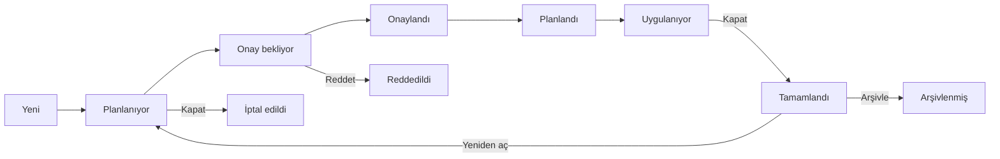

Değişiklik, BT altyapısında ya da hizmetlerde planlı olarak yapılan bir işin kaydıdır: bir sunucunun taşınması, bir güvenlik yamasının uygulanması, bir ağ cihazının yazılımının yükseltilmesi gibi. Değişiklik kayıt olarak açılır, nedeni ve planı yazılır, CAB (değişiklik danışma kurulu) ya da onay akışı tarafından onaylanır, uygulanır ve sonucu gözden geçirilir.

<Callout type="info" title="ÖNEMLİ">Bu bölüm ServiceCore'un yeni değişiklik arayüzünü anlatır. Mevcut ekranlar için bkz. [Değişiklikler](/docs/teknisyen/moduller/degisiklikler).</Callout>

## Ekranın bölümleri

| # | Bölüm | Ne işe yarar |
|---|---|---|
| ❶ | `Değişiklikler` | Kenar çubuğunda modülün girişi. |
| ❷ | Görünüm sekmeleri | Hazır ve kayıtlı görünümler. Bkz. [Filtreler ve Görünümler](/docs/teknisyen/moduller/degisiklikler-v2/filtreler-ve-gorunumler). |
| ❸ | **Yeni değişiklik** | Oluşturma panelini açar. Bkz. [Değişiklik Oluşturma](/docs/teknisyen/moduller/degisiklikler-v2/olusturma). |
| ❹ | Araç çubuğu | Filtre, liste ile takvim arasında geçiş, arama, yenileme ve Excel'e aktarma. Bkz. [Değişiklik Listesi](/docs/teknisyen/moduller/degisiklikler-v2/liste). |
| ❺ | Liste | Değişiklikler satır satır. Satıra basınca değişiklik yan panelde, `Tam sayfada aç` ile kendi sayfasında açılır. |

## Durumlar ve aşamalar

Her durum üç aşamadan birine bağlıdır: `Açık`, `Beklemede` ya da `Kapalı`. Durum adları kurumunuzun tanımına göre değişebilir; aşağıdaki tablo örnek kurulumu gösterir.

| Aşama | Durumlar |
|---|---|
| `Açık` | `Yeni`, `Planlanıyor`, `Onaylandı`, `Planlandı`, `Uygulanıyor` |
| `Beklemede` | **Onay bekliyor**, `Beklemede` |
| `Kapalı` | `Tamamlandı`, **İptal edildi**, `Reddedildi` |

Yeni değişiklik `Yeni` durumuyla açılır. Durumu siz değiştirirsiniz; onayın sonuçlanması durumu kendiliğinden değiştirmez. Örneğin CAB değişikliği onayladığında durumu `Onaylandı` ya da `Planlandı` yapmak teknisyenin işidir.

Şema tipik yolu gösterir, bütün geçişleri değil: açık ve beklemedeki durumlar arasında istediğiniz yöne geçebilirsiniz. Ayrıntı için bkz. [Durumlar ve Kapatma](/docs/teknisyen/moduller/degisiklikler-v2/durumlar-ve-kapatma).

## Onay

Değişikliğin onayı iki biçimden biriyle yürür:

| Onay biçimi | Nasıl çalışır |
|---|---|
| **Klasik CAB** | Değişikliğe CAB üyeleri eklenir ve onaya gönderilir. Üyelerin hepsi onaylarsa değişiklik onaylanır, bir üyenin reddi bütün CAB'ı reddeder. |
| **Gelişmiş onay akışı** | Kurumunuzda tanımlı akış adım adım ilerler. Her adımın kipi kaç kararın yeteceğini belirler. |

Onay durumu listede `Onay` sütununda ve değişikliğin başlığında etiket olarak görünür:

| Etiket | Anlamı |
|---|---|
| **Onay bekliyor · 1/3** | Onay sürüyor; üç karardan biri verildi. |
| **Onayınızı bekliyor** | Sizin kararınız bekleniyor. |
| **Onaylandı · 2/2** | Onay sonuçlandı: onaylandı. |
| **Reddedildi · 1/2** | Onay sonuçlandı: reddedildi. |
| **Revize istendi** | Bir onaycı düzeltme istedi. |
| **Onay gerekmez** | Değişikliğe onaycı eklenmedi. |
| **İptal edildi**, **Süresi doldu** | Onay değişiklik kapanınca iptal edildi ya da zamanında sonuçlanmadı. |

Kararların nasıl verildiği için bkz. [Onay (CAB)](/docs/teknisyen/moduller/degisiklikler-v2/onay).

## Dondurma ve bakım pencereleri

**Dondurma penceresi**, belirli bir dönemde değişiklik yapılmasını kısıtlar: yıl sonu kapanışı, kampanya haftası, bir projenin geçiş dönemi gibi. Değişikliğin planlanan aralığı bir dondurma penceresine denk gelirse uyarı çıkar. Engelleyen bir pencerede değişiklik kaydedilemez; uyaran bir pencerede kaydedilir ama uyarı durur.

**Bakım penceresi** ise değişikliğin uygulanabileceği aralıktır ve değişikliğin `Planlama` sekmesinde tanımlanır. İkisi de [Takvim](/docs/teknisyen/moduller/degisiklikler-v2/takvim) görünümünde görünür.

## Yetkiler

Değişiklik modülünde ayrı yetkiler vardır: görme, oluşturma, düzenleme, kapatma (yeniden açma dahil), reddetme, silme ve silinmişleri görme. Arşivleme düzenleme yetkisiyle yapılır.

Kaydın hâline uymayan bir işlem hiç görünmez. Örneğin kapalı değişiklikte `Kapat` yoktur, onun yerine **Yeniden aç** görünür. Kapalı değişiklikte yalnız yeniden açma, not ekleme, arşivleme ve silme yapılabilir. Arşivlenmiş değişiklik yalnız yazdırılabilir, silinmiş değişiklikte hiçbir işlem yoktur.

Hâline uyan ama yetkiniz olmayan işlem menüde pasif görünür ve altında nedeni yazar, ör. **Bu değişikliği silme yetkiniz yok.** Oluşturma yetkiniz yoksa **Yeni değişiklik** düğmesi görünmez.

## Diğer modüllerle bağlantı

| Modül | Bağlantı |
|---|---|
| Olay, Problem | Değişiklik olaylara ve problemlere bağlanır; `Süreçler` sekmesinden yeni olay ya da problem açılıp bağlanabilir. |
| İstek, Sürekli iyileştirme | Değişikliğe bağlanabilir. |
| Proje | Değişikliğin tek bir proje bağı olur. Projeye ait dondurma pencereleri değişikliği etkiler. |
| Varlık, Hizmet | Değişikliğin dokunduğu varlıklar ve hizmetler `Süreçler` sekmesinde bağlanır. |
| Sürüm | Değişikliği taşıyan sürümler `Süreçler` sekmesinde salt okunur listelenir. |

Bkz. [Süreçler](/docs/teknisyen/moduller/degisiklikler-v2/surecler).
