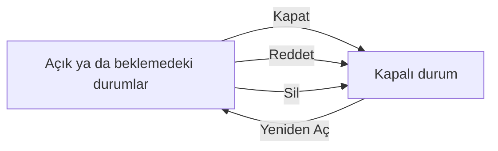

Değişiklik uygulandıktan sonra sonuçları değerlendirilir ve değişiklik kapatılır. Bu sayfada gözden geçirme sekmesi ve bir değişikliği kapalı aşamaya geçirmenin bütün yolları anlatılır.

## Gözden geçirme

`Gözden Geçirme - İzleme` sekmesi, değişikliğin uygulandıktan sonra ne zaman ve nasıl değerlendirileceğini tutar. Sekme çubuğuna sığmadığında bu sekme `…` menüsünde yer alır.

| # | Açıklama |
|---|---|
| ❶ | **Bir Sonraki Gözden Geçirme Tarihi** — Değerlendirmenin yapılacağı tarihtir. Tarihi seçtikten sonra yanındaki `Kaydet` düğmesine basın. |
| ❷ | **Sil** — Gözden geçirme tarihini, notlarını ve eklerini birlikte siler. İşlemden önce onay istenir. |
| ❸ | **Gözden Geçirme Notları** — Değerlendirmede bakılacak noktaları ya da değerlendirmenin sonucunu yazdığınız karttır. Kalem simgesiyle düzenledikten sonra kartın altındaki `Kaydet` düğmesine basın. |
| ❹ | `Dosyalar` — Gözden geçirmeye ait dosyaları listeler. Sağdaki simgeyle dosya yükleyebilirsiniz. |

## Durumlar

Her değişikliğin bir durumu vardır ve her durum bir **aşamaya** aittir. Aşama, değişikliğin listede görünüp görünmeyeceğini ve hangi işlemlerin yapılabileceğini belirler.

| Durum | Ne zaman kullanılır |
|---|---|
| `Açık` | **Açık aşama.** Yeni değişikliğin varsayılan durumu. |
| **Kapatılanlar** | **Kapalı aşama.** Değişiklik kapatıldı, reddedildi ya da silindi. |

Durum listesi yöneticiler tarafından genişletilebilir. Bu nedenle kurumunuzda açık, beklemede ve kapalı aşamalarda başka durumlar da görebilirsiniz.

Açık ve beklemedeki durumlar arasında serbestçe geçebilirsiniz. Bunun için `Özellikler` panelindeki `Durum` alanını, kartın `Hızlı Güncelleme` simgesini ya da toplu işlemi kullanın. Kapalı bir duruma ise yalnızca kapatma, reddetme ya da silme işlemiyle geçilir. Kapalı bir değişikliği tekrar açık aşamaya almak için yeniden açma işlemi kullanılır.

Liste açılışta kapalı aşamadaki değişiklikleri göstermez. Bu değişiklikleri görmek için `Kontrol Paneli` içindeki `Aşama` alanından `Kapalı` seçeneğini seçin.

## Değişikliği kapatma

Değişikliğin araç çubuğundaki `Kapat` düğmesi `Kapatma Bilgileri` penceresini açar.

| # | Açıklama |
|---|---|
| ❶ | `Gerekçe` — Değişikliğin neden kapatıldığını belirtir ve kurumunuzda tanımlı kapatma gerekçelerinden seçilir. İsteğe bağlıdır. |
| ❷ | `Durum` — **Zorunlu.** Değişikliğin alacağı kapalı durumdur, örneğin `Kapatılanlar`. |
| ❸ | **Kapatma Açıklaması** — **Zorunlu.** Değişikliğin nasıl sonuçlandığını kısaca açıklayın. Bu açıklama sağ paneldeki `Kullanıcı / Bilgiler` bölümünde görünür. |

Değişiklik kapatıldığında:

- Henüz yanıt vermemiş danışılan kişilerin durumu **Onay Süresi Doldu** olur. Bkz. [Tavsiyeler ve Onaylar](/docs/teknisyen/moduller/degisiklikler/tavsiyeler-ve-onaylar).
- Değişikliğe kapatma açıklamasını içeren bir sistem notu eklenir.
- Sistem yöneticiniz `Genel Ayarlar` ekranında **Değişiklik kaydı kapatıldığında ilişkili istek kayıtlarını da kapat** ayarını açtıysa değişikliğe bağlı istekler de kapatılır.

Birden fazla değişikliği birlikte kapatmak için değişiklikleri listede seçip toplu işlem çubuğundaki `Kapat` düğmesini kullanın. Bkz. [Değişiklik Listesi](/docs/teknisyen/moduller/degisiklikler/liste#toplu-işlemler).

## Reddetme

Değişiklik uygulanmayacaksa `Diğer Eylemler` › `Reddet` ile reddedilir. Açılan `Reddet` penceresinde kapatma penceresindeki alanların aynısı bulunur: `Gerekçe`, zorunlu `Durum` ve zorunlu **Kapatma Açıklaması**. İşlemi onaylamak için penceredeki `Kapat` düğmesine basın.

Reddetmenin kapatmadan iki farkı vardır:

- Kapatma kuralları uygulanmaz. Planlama eksik olsa ya da açık görev bulunsa da değişiklik reddedilebilir.
- Ayrı bir yetki gerektirir. Bkz. [Yetkiler](/docs/teknisyen/moduller/degisiklikler/yetkiler).

## Kapalı değişiklik

Kapalı bir değişiklikte `Kapat` düğmesinin yerinde `Yeniden Aç` ❶ düğmesi görünür ve `Özellikler` alanları salt okunur hâle gelir. Sağ paneldeki `Kullanıcı / Bilgiler` bölümünde kapatılma tarihi ve kapatma açıklaması ❷ yer alır.

## Yeniden açma

`Yeniden Aç` düğmesi bir pencere açar. `Durum` ❶ alanından değişikliğin alacağı açık ya da beklemedeki durumu seçin ve penceredeki `Yeniden Aç` düğmesine basın.

## Silme

Bir değişikliği silmek için araç çubuğundaki `Diğer Eylemler` › `Sil` seçeneğini ya da listedeki toplu `Sil` düğmesini kullanın. Açılan pencerede bir **Silme Gerekçesi** yazmanız ve kapalı bir `Durum` seçmeniz istenir; iki alan da zorunludur. Silinen değişiklikler listede ve takvimde görünmez. Silinen kayıtları görme yetkisi olan kullanıcılar bu değişiklikleri `Kontrol Paneli` içindeki `Silinmiş mi?` kutusuyla listeleyebilir.

## Arşivleme

`Diğer Eylemler` › `Arşivle`, açık bir değişikliği arşive kaldırır. Arşivlenen değişiklikler varsayılan listede görünmez; bu değişiklikleri `Kontrol Paneli` içindeki `Arşivlenmiş mi?` kutusuyla listeleyebilirsiniz.

## Kapatma kuralları

Sistem yöneticiniz, bir değişikliğin kapatılabilmesi için bazı koşulları zorunlu tutabilir. Kurallar varsayılan olarak kapalıdır. Açılabilecek kurallar şunlardır:

| Kural | Kapatmadan önce gereken |
|---|---|
| Alanlar | Açıklama, kategori, iş etkisi, öncelik, teknisyen, teknisyen grubu ya da bölüm alanları dolu olmalıdır. |
| Planlama | Değişiklik gerekçesi, etki açıklaması, uygulama planı, geri dönüş planı ya da planlanan başlangıç ve bitiş tarihleri girilmiş olmalıdır. |
| Tavsiye | En az bir danışılacak kişi eklenmiş olmalıdır. |
| Gözden geçirme | Gözden geçirme notu girilmiş olmalıdır. |
| Görevler | İlişkili görevler kapatılmış ya da görevlere iş günlüğü girilmiş olmalıdır (iki ayrı kural). |
| İş günlüğü, not | Değişiklikte iş günlüğü ya da not bulunmalıdır. |
| Varlık ve hizmet | En az bir varlık ya da hizmet eklenmiş olmalıdır. |
| Kapatma açıklaması | Kapatma açıklaması yazılmış olmalıdır. |

Karşılanmayan bir kural varsa `Kapat` düğmesine bastığınızda pencere açılmaz; bunun yerine ekranın sağ altında eksik kuralları listeleyen bir uyarı görünür. Formdaki zorunlu alanlar boşsa `Kapat` düğmesi kilitlenir ve fareyle üzerine geldiğinizde eksik alanlar listelenir.

Tavsiye kuralı yalnızca danışılacak kişi eklenip eklenmediğine bakar; kişilerin onay verip vermediğini denetlemez.
