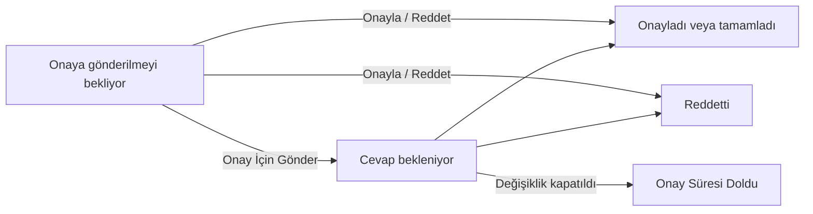

Bir değişiklik uygulanmadan önce servis sahiplerinin, teknik uzmanların, danışmanların ve yöneticilerin görüşü alınır. `Tavsiyeler` sekmesinde danışılacak kişileri ekleyebilir, onlara onay isteği gönderebilir ve yanıtlarını tek bir tabloda izleyebilirsiniz. Kişileri kurumunuzdaki bir danışma kurulundan seçebilir ya da kurum dışındaki uzmanları e-posta adresleriyle ekleyebilirsiniz.

## Tavsiyeler sekmesi

| # | Açıklama |
|---|---|
| ❶ | **Danışılacak Kişileri Ekle** — Yeni kişi ekleme penceresini açar. Henüz kimse eklenmemişse sekmede **Değişiklik Hakkında Tavsiye Topla** başlığı ve **Değişiklik Danışılacak Kişileri Ekle** düğmesi görünür. |
| ❷ | `Durum` — Danışılan kişinin yanıt durumunu gösterir. Durumlar aşağıdaki tabloda açıklanmıştır. |
| ❸ | `Onayla / Reddet` — Kişinin yanıtını sizin girmenizi sağlar. Örneğin onayı toplantıda ya da telefonla aldıysanız bu düğmeyi kullanın. Yanıt verilmiş satırlarda düğme pasiftir. |
| ❹ | `Onay İçin Gönder` — Kişiye onay isteği gönderir; göndermeden önce bir açıklama yazmanız istenir. Yanıt beklenen ve onaylanmış satırlarda düğme pasiftir. |
| ❺ | **Sil** — Kişiyi danışılacaklar listesinden çıkarır. |

Tabloda ayrıca şu sütunlar bulunur: gönderirken yazdığınız açıklama (`Gönderme Açıklaması`), kişinin yanıt açıklaması (`Açıklama`), `İstek Tarihi` ve `Sonuç tarihi`.

### Yanıt durumları

| Durum | Anlamı |
|---|---|
| **Onaya gönderilmeyi bekliyor.** | Kişi eklendi, onay isteği henüz gönderilmedi. |
| **Cevap bekleniyor.** | Onay isteği gönderildi, yanıt bekleniyor. |
| **Onayladı veya tamamladı.** | Kişi değişikliği onayladı. |
| **Reddetti.** | Kişi değişikliği reddetti. |
| **Onay Süresi Doldu** | Kişi yanıt vermeden değişiklik kapatıldı. |

Şema, tek bir kişinin yanıt durumunun nasıl değiştiğini gösterir. Onay isteği gönderildiğinde danışılan kişiye bildirim gider. Kişi teknisyense isteği kullanıcı menüsündeki `Onaylarım` sayfasından, son kullanıcıysa portaldan yanıtlar.

<Callout type="warn" title="DİKKAT">
Danışma sonucu değişikliğin durumunu kendiliğinden değiştirmez. Bütün kişiler onaylasa da değişiklik `Açık` durumda kalır. Uygulamaya geçme, değişikliği kapatma ya da reddetme kararını siz verirsiniz.
</Callout>

## Danışılacak kişileri ekleme

| # | Açıklama |
|---|---|
| ❶ | `Danışma Kurulu` — Kurumunuzda tanımlı bir değişiklik danışma kurulunu seçerseniz kurulun üyeleri listeye eklenir. |
| ❷ | `Danışılacak Kişiler` — Sistemdeki kullanıcılar arasından kişileri tek tek seçmenizi sağlar. |
| ❸ | **Danışılacak Diğer Üyeler (Dış Kaynaklar, Danışmanlar vb)** — Sistemde kaydı olmayan kişilerin e-posta adreslerini girdiğiniz alandır. |

`Danışılacak Kişiler` ya da `Danışılacak Diğer Üyeler` alanlarından en az birini doldurmanız gerekir. `Kaydet` düğmesine bastığınızda kişiler tabloya **Onaya gönderilmeyi bekliyor.** durumuyla eklenir. Onay isteği, ancak satırdaki `Onay İçin Gönder` düğmesine bastığınızda gönderilir.

## Yanıtı elle girme

`Onayla / Reddet` düğmesi `Danışmayı Onayla` penceresini açar.

| # | Açıklama |
|---|---|
| ❶ | `Açıklama` — **Zorunlu.** Yanıtın gerekçesidir ve en az üç karakter olmalıdır. Tablodaki `Açıklama` sütununda görünür. |
| ❷ | `Reddet` ve `Onayla` — Kişinin yanıtını kaydeder. |

## İş akışı ve onay zaman çizelgesi

Sistem yöneticiniz bir otomasyon kuralıyla değişikliklere çok adımlı bir onay iş akışı bağlayabilir. Örneğin önce teknisyen grubunun, sonra yöneticinin, en son da danışma kurulunun onayı istenebilir. Böyle bir iş akışının çalıştığı değişikliklerde `İş Akışı` sekmesi kullanılır:

- `İş Akışı` alt sekmesi, iş akışının şemasını ve değişikliğin hangi adımda olduğunu gösterir.
- `Onay Zaman Çizelgesi` alt sekmesi, her onay adımını bir satırda listeler. Satırlarda `Aşama`, `Onayı Tetikleyen`, `Onaylayan`, `Onay İsteme Zamanı`, `Onay durumu`, `Karar Tarihi` ve `Onay Açıklaması` bilgileri yer alır. Satırdaki `Onay İçin Gönder` düğmesi, onay e-postasını onaylayana yeniden gönderir.

Değişikliğe bağlı bir iş akışı yoksa `İş Akışı` alt sekmesinde yalnızca başlangıç adımı görünür ve onay zaman çizelgesi boş kalır. Kurumunuzda iş akışı tanımlı olup olmadığını sistem yöneticinize sorun.
