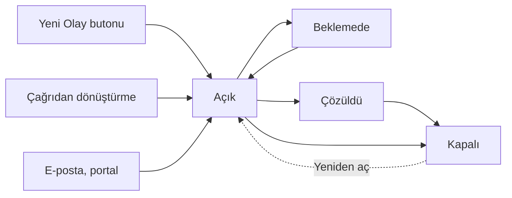

Olay, bir hizmetin beklenmedik şekilde kesilmesi ya da kalitesinin düşmesidir. Olay modülünde
amaç, hizmeti en kısa sürede normale döndürmektir: olay kaydedilir, bir teknisyene atanır, SLA
süresi içinde çözülür ve kapatılır. Modüle üst menüdeki `Olay` simgesinden girilir.

<Callout type="info" title="ÖNEMLİ">
Bu bölüm **yeni olay ekranlarını** anlatır. Yeni ekranlar `Genel Ayarlar ▸ Uygulama Ayarları`
altındaki **Yeni Olaylar sayfalarına yönlendir (beta)** seçeneğiyle açılır.
</Callout>

## Ekranın bölümleri

| # | Bölüm | Ne işe yarar |
|---|---|---|
| ❶ | `Yeni Olay` | Yeni olay kaydı açar. Bkz. [Olay Oluşturma](/docs/teknisyen/moduller/olaylar/olusturma) |
| ❷ | Yeni Zamanlanmış Olay | Belirli aralıklarla kendiliğinden açılacak bir olay tanımlar |
| ❸ | Olay numarası ve durum | `#INC` ile başlayan numara ve olayın durumu. Karta tıklayınca olay açılır. Bkz. [Olay Listesi](/docs/teknisyen/moduller/olaylar/liste) |
| ❹ | Olay bilgileri | Teknisyen grubu, teknisyen, kullanıcı, hedef çözüm tarihi, kalan SLA süresi (yüzde) ve öncelik |
| ❺ | `Filtre Görünümleri` ve `Kontrol Paneli` | Kayıtlı filtreler ve listeyi alan alan süzme. Bkz. [Filtreler](/docs/teknisyen/moduller/olaylar/filtreler) |

## Olay nereden gelir?

- **Teknisyen:** `Yeni Olay` butonuyla; telefonla ya da yüz yüze bildirilen arızalar için.
- **Çağrıdan:** Çağrı modülünde çağrı olaya dönüştürülünce. Bkz. [Çağrıyı Dönüştürme](/docs/teknisyen/moduller/cagrilar/donusturme).
- **E-postadan:** Yöneticinizin e-posta yakalayıcısında tipi `Olay` seçtiği adreslere gelen mesajlar
  doğrudan olay olur; tipi `Çağrı` olan adreslere gelenler önce çağrı listesine düşer.
- **Son kullanıcı portalından** ve **entegrasyonlardan**.
- **Zamanlanmış olaydan:** Tanımlanan aralıkta kendiliğinden açılır.

## Olayın yaşam döngüsü

- **Atama:** Olay bir teknisyen grubuna ve teknisyene atanır. Yöneticiniz otomatik teknisyen atama
  kuralı tanımladıysa atama kurala göre kendiliğinden yapılır.
- **Durum ve aşama:** Durumlar kurumunuza göre tanımlanır ve her biri `Açık`, `Beklemede` ya da
  `Kapalı` aşamalarından birine bağlıdır.
- **SLA:** Hedef cevap ve çözüm tarihleri olayın önceliğine ve eşleşen SLA politikasına göre
  hesaplanır. Olay beklemedeki bir duruma alındığında SLA süresi durur; beklemede geçen süre hedef
  tarihe eklenir.
- **Çözme ve kapatma:** Çözülen olay, kurumunuzda "çözüldü" kabul edilen duruma alınır ve kapatılır.
  Bkz. [Durumlar ve Kapatma](/docs/teknisyen/moduller/olaylar/durumlar-ve-kapatma).

## Diğer modüllerle bağlantı

- **Çağrılar:** Kullanıcıdan gelen ve olay olduğu anlaşılan çağrı olaya dönüştürülür; çağrının
  konusu, açıklaması, ekleri ve e-posta yazışmaları olaya aktarılır.
- **Problemler ve değişiklikler:** Tekrar eden olaylar için olayın `Süreçler` sekmesinden yeni
  problem açılır ya da var olan probleme bağlanır; aynı yerden istek, değişiklik, iyileştirme ve
  proje kayıtları da bağlanır. Bkz. [Detay Sekmeleri](/docs/teknisyen/moduller/olaylar/sekmeler).
- **Bilgi Bankası:** Çözüm eklerken Bilgi Bankası'ndaki bir sayfa seçilebilir ya da çözüm, çözüm
  şablonu olarak eklenebilir.
- **Görevler:** Olay üzerinde teknisyenlere görev açılır; görevlerin iş günlükleri olayın eforuna yansır.
