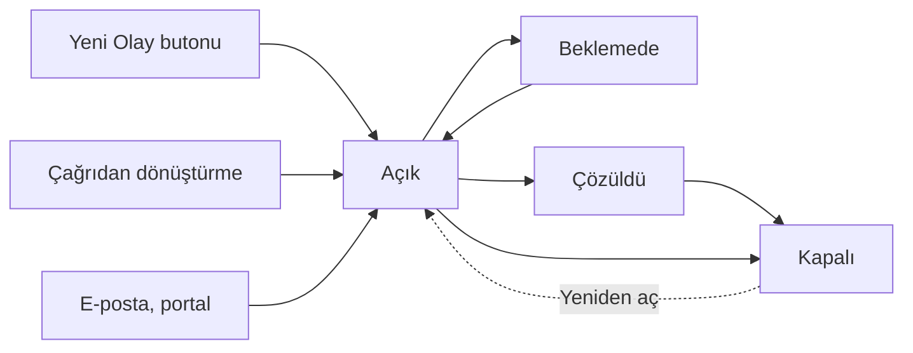

Olay, bir hizmetin beklenmedik şekilde kesilmesi ya da kalitesinin düşmesidir. Olay modülünde
amaç, hizmeti en kısa sürede normale döndürmektir: olay kaydedilir, bir teknisyene atanır, SLA
süresi içinde çözülür ve kapatılır.

<Callout type="info" title="ÖNEMLİ">
Bu sayfa **yeni olay ekranlarını** anlatır. Yeni ekranlar `Genel Ayarlar ▸ Uygulama Ayarları`
altındaki **Yeni Olaylar sayfalarına yönlendir (beta)** seçeneğiyle açılır.
</Callout>

## Olay listesi

Üst menüden `Olay` seçildiğinde açık olaylar kart olarak listelenir; en yeni olay en üsttedir.

| # | Bölüm | Ne işe yarar |
|---|---|---|
| ❶ | `Yeni Olay` | Telefonla ya da yüz yüze bildirilen arıza için olay kaydı açar |
| ❷ | Yeni Zamanlanmış Olay | Belirli aralıklarla kendiliğinden açılacak bir olay tanımlar (ör. periyodik bakım kontrolü) |
| ❸ | Olay numarası ve durum | `#INC` ile başlayan numara ve olayın durumu |
| ❹ | Olay bilgileri | Teknisyen grubu, teknisyen, kullanıcı, hedef çözüm tarihi, kalan SLA süresi (yüzde) ve öncelik |
| ❺ | `Filtre Görünümleri` ve `Kontrol Paneli` | Kaydedilmiş filtreler ve listeyi numara, konu, durum, teknisyen gibi alanlara göre süzme |

Olaylar listeye şu yollarla da gelir:

- **Çağrıdan:** Çağrı modülünde çağrı olaya dönüştürülünce. Bkz. [Çağrıyı Dönüştürme](/docs/teknisyen/moduller/cagrilar/donusturme).
- **E-postadan:** Yöneticinizin e-posta yakalayıcısında tipi `Olay` seçtiği adreslere gelen mesajlar
  doğrudan olay olur; tipi `Çağrı` olan adreslere gelenler önce çağrı listesine düşer.
- **Son kullanıcı portalından** ve **entegrasyonlardan**.

## Olay üzerinde çalışma

Karta tıklandığında olayın detayı açılır.

| # | Bölüm | Ne işe yarar |
|---|---|---|
| ❶ | Sekmeler | `Görevler`, `İş Günlükleri`, `Çözümler`, `Süreçler` (bağlı problem, istek, değişiklik, iyileştirme ve diğer olaylar) ve `Geçmiş` |
| ❷ | Konu ve açıklama | Kullanıcının bildirdiği sorun |
| ❸ | `Görüşmeler` | `Cevapla`, `Tümünü Cevapla` ve `İlet` ile e-posta gönderilir, `Not Ekle` ile iç not yazılır. Kullanıcının bu e-postalara verdiği yanıtlar aynı olaya eklenir |
| ❹ | `Kaydet`, `Bana Ata`, `Kapat` | Değişiklikleri kaydeder, olayı size atar, olayı kapatır. Yanındaki `⋮` menüsünde çözüm, görev ve iş günlüğü ekleme, paylaşma, arşivleme gibi diğer işlemler bulunur |
| ❺ | `Kullanıcı / Bilgiler` | Olayı bildiren kişinin iletişim bilgileri |
| ❻ | `SLA` | Uygulanan SLA politikası, hedef cevap ve çözüm tarihleri, beklemede geçen süre |
| ❼ | `Özellikler` | Durum, öncelik, teknisyen grubu, teknisyen, kategori gibi alanlar |

- **Atama:** Teknisyen grubu ve teknisyen `Özellikler`'den seçilir. Yöneticiniz otomatik teknisyen
  atama kuralı tanımladıysa olay kurala göre kendiliğinden atanır.
- **Durum:** Durumlar kurumunuza göre tanımlanır ve her biri `Açık`, `Beklemede` ya da `Kapalı`
  aşamalarından birine bağlıdır.
- **SLA:** Hedef tarihler olayın önceliğine ve eşleşen SLA politikasına göre hesaplanır. Olay
  beklemedeki bir duruma alındığında SLA süresi durur; beklemede geçen süre hedef tarihe eklenir.

## Çözme ve kapatma

Sorun giderildiğinde olayın durumu, kurumunuzda "çözüldü" kabul edilen duruma alınır. Denenen ve
işe yarayan çözümler `Çözümler` sekmesine kaydedilir. Yöneticiniz otomatik kapatma süresi
tanımladıysa çözülen olay bu sürenin sonunda kendiliğinden kapanır. Olayı hemen kapatmak için
`Kapat` butonunu kullanın:

| # | Alan | Açıklama |
|---|---|---|
| ❶ | `Gerekçe` | Kapatma gerekçesi |
| ❷ | `Durum` | Olayın alacağı kapalı durum. **Zorunludur** |
| ❸ | `Kapatma Açıklaması` | Yapılan işin kısa açıklaması. Kurumunuzun ayarına göre zorunlu olabilir |
| ❹ | `Kapat` | Olayı kapatır |

Kurumunuzda kapatma kuralları tanımlıysa (ör. kategori seçilmiş ya da iş günlüğü girilmiş olmalı)
eksik bilgi tamamlanmadan olay kapatılamaz; ekranda neyin eksik olduğu gösterilir. Kapalı bir olay
`Yeniden Aç` butonuyla tekrar açılır; kullanıcının kapalı olaya e-postayla yanıt vermesi de kurum
ayarına göre olayı yeniden açar.
