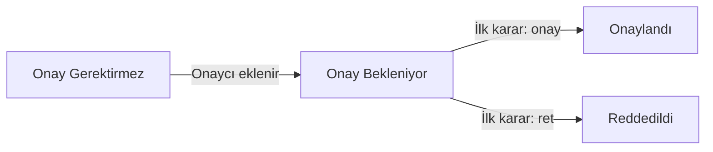

Sözleşmenin onaya sunulması `Tavsiyeler` sekmesinden yürütülür. Onaycı bir danışma kurulu, kurum içi bir kullanıcı ya da kurum dışı bir e-posta adresi olabilir.

**İlk karar sonucu belirler.** Onaycılardan biri onaylarsa sözleşme `Onaylandı` olur ve diğer onaycıların satırı **Onay Süresi Doldu** durumuna geçer. Biri reddederse sözleşme `Reddedildi` olur ve salt okunur kalır. Sonuçlanan süreçte onaycı eklenemez, çıkarılamaz, onaya gönderilemez.

## Tavsiyeler sekmesi

| # | Öğe | Ne işe yarar |
|---|---|---|
| ❶ | Onay durumu | Sözleşmenin onay durumu. İlk onaycı eklenince **Onay Bekleniyor** olur. |
| ❷ | **Sözleşmeyi Onaylayacak Kişileri Ekle** | Onaycı ekleme penceresini açar. |
| ❸ | **Danışılan Kişi** | Onaycının adı ya da e-posta adresi. |
| ❹ | `Durum` | Onaycının satırının durumu; aşağıya bakın. |
| ❺ | **Onayla / Reddet** | Kararı onaycı adına sizin vermenizi sağlar. |
| ❻ | **Onay İçin Gönder** | Onay isteğini onaycıya gönderir. |
| ❼ | Sil | Onaycıyı çıkarır. |

Tablonun öbür sütunları **Gönderme Açıklaması** (gönderirken yazılan not), `Açıklama` (karar notu), **İstek Tarihi** ve **Sonuç tarihi**dir.

| Satır durumu | Anlamı |
|---|---|
| **Onaya gönderilmeyi bekliyor.** | Onaycı eklendi, istek henüz gönderilmedi. |
| **Cevap bekleniyor.** | İstek gönderildi, karar bekleniyor. |
| **Onayladı veya tamamladı.** | Onaycı onayladı. |
| `Reddetti.` | Onaycı reddetti. |
| **Onay Süresi Doldu** | Başka bir onaycının kararı süreci sonuçlandırdı. |

## Onaycı ekleme

| # | Alan | Ne işe yarar |
|---|---|---|
| ❶ | **Danışma Kurulu** | Tanımlı bir danışma kurulu. |
| ❷ | **Danışılacak Kişiler** | Kurum içi kullanıcılar. |
| ❸ | **Danışılacak Diğer Üyeler** | Kurum dışı e-posta adresleri (danışman, tedarikçi vb.). |

En az bir onaycı seçilmelidir. Aynı e-posta adresi iki kez eklenmez.

## Onaya gönderme

| # | Öğe | Ne işe yarar |
|---|---|---|
| ❶ | `Açıklama` | Onaycıya gidecek not. Zorunlu, en az 3 karakter. |
| ❷ | `Gönder` | İsteği e-postayla gönderir; satır **Cevap bekleniyor.** olur. |

Kurum içi onaycı isteği son kullanıcı portalındaki **Onaylarım** listesinde de görür. Kurum dışı onaycı kararını e-postadaki bağlantıdan açılan sayfada verir.

## Onaylama ve reddetme

| # | Öğe | Ne işe yarar |
|---|---|---|
| ❶ | `Açıklama` | Kararın gerekçesi. Zorunlu, en az 3 karakter. |
| ❷ | `Reddet` | Onaycı adına reddeder. |
| ❸ | `Onayla` | Onaycı adına onaylar. |

**Onayla / Reddet** düğmesi, istek gönderilmeden önce de etkindir.

## Yetkiler

| İşlem | Gerekli yetki |
|---|---|
| Onaycı ekleme, onaya gönderme | **Sözleşme Düzenleyebilir** |
| **Onayla / Reddet** düğmesinin görünmesi | **Sözleşme Düzenleyebilir** |
| Onaycı satırını silme | **Sözleşme Silebilir** |

Onay olayları sözleşmenin `Geçmiş` sekmesine yazılır.
