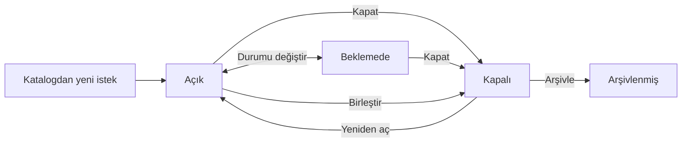

İstek, bir kullanıcının hizmet katalogundan talep ettiği bir hizmettir: yeni bir dizüstü bilgisayar, bir yazılım lisansı, bir klasöre erişim yetkisi gibi. Her istek bir katalog öğesinden açılır. Öğe, isteğin konusunu, açıklamasını, onay akışını ve hazır görevlerini belirler. Teknisyen isteği hazırlar, gerekirse onaya sunar ve iş bitince kapatır.

<Callout type="info" title="ÖNEMLİ">Bu bölüm ServiceCore'un yeni istek arayüzünü anlatır. Mevcut ekranlar için bkz. [İstekler](/docs/teknisyen/moduller/talepler).</Callout>

## Ekranın bölümleri

| # | Bölüm | Ne işe yarar |
|---|---|---|
| ❶ | `İstekler` | Kenar çubuğunda modülün girişi. Yanındaki sayı size atanmış açık isteklerin sayısıdır. |
| ❷ | `Katalog` | Hizmet katalogu. Yeni istek buradan açılır. Bkz. [İstek Oluşturma](/docs/teknisyen/moduller/talepler-v2/olusturma). |
| ❸ | Görünüm sekmeleri | Hazır ve kayıtlı görünümler. Bkz. [Filtreler ve Görünümler](/docs/teknisyen/moduller/talepler-v2/filtreler-ve-gorunumler). |
| ❹ | `Yeni istek` | Katalogu açar; isteği bir katalog öğesi seçerek açarsınız. |
| ❺ | Araç çubuğu | Filtre, arama, yenileme ve Excel'e aktarma. Bkz. [İstek Listesi](/docs/teknisyen/moduller/talepler-v2/liste). |
| ❻ | Liste | İstekler satır satır. Numaraya basınca istek yan panelde, `Tam sayfada aç` ile kendi sayfasında açılır. |

## Durumlar ve aşamalar

Her durum üç aşamadan birine bağlıdır. Durum adları kurumunuzun tanımına göre değişebilir; aşağıdaki tablo örnek kurulumu gösterir.

| Aşama | Durumlar |
|---|---|
| `Açık` | `Açık`, `Atandı`, `Hazırlanıyor` |
| `Beklemede` | **Onay bekliyor**, **Bilgi bekleniyor** |
| `Kapalı` | `Tamamlandı`, **İptal edildi** |

Beklemedeki bir istekte SLA sayacı durur. Kapalı istek değiştirilemez; değiştirmek için önce yeniden açılır.

Şema bütün işlemleri göstermez. Geçişlerin ayrıntısı için bkz. [Durumlar ve Kapatma](/docs/teknisyen/moduller/talepler-v2/durumlar-ve-kapatma).

## Onay

Katalog öğesi onay gerektiriyorsa istek açılınca onay akışı başlar. İsteğin onay durumu listede `Onay` sütununda ve isteğin başlığında etiket olarak görünür:

| Etiket | Anlamı |
|---|---|
| **Onay bekliyor · 1/3** | Akış sürüyor; üç adımdan biri tamamlandı. |
| **Onayınızı bekliyor** | Akışta sizin kararınız bekleniyor. |
| `Onaylandı`, `Reddedildi` | Akış sonuçlandı. |
| **Revize istendi** | Bir onaycı düzeltme istedi; istek yeniden onaya gönderilmeyi bekliyor. |
| **Onay gerekmez** | Öğe onay istemiyor. |
| **Süresi doldu**, **İptal edildi** | Akış zamanında sonuçlanmadı ya da istek kapanınca iptal edildi. |

Kararların nasıl verildiği için bkz. [Onay](/docs/teknisyen/moduller/talepler-v2/onay).

## Yetkiler

Kaydın hâline uymayan bir işlem hiç görünmez. Örneğin kapalı istekte `Kapat` yoktur, onun yerine `Yeniden aç` görünür. Silinmiş istek değiştirilemez; arşivlenmiş istek yalnız paylaşılabilir.

Hâline uyan ama yetkiniz olmayan işlem ise menüde pasif görünür ve altında nedeni yazar, ör. `Bu isteği silme yetkiniz yok.` İstek açma yetkiniz yoksa `Yeni istek` düğmesi görünmez.

## Diğer modüllerle bağlantı

| Modül | Bağlantı |
|---|---|
| Katalog | Her istek bir katalog öğesinden açılır. Öğenin adı isteğin `Katalog öğesi` alanında bağlantı olarak durur. |
| Olay | İstek bir olaya bağlanabilir ya da `Süreçler` sekmesinden yeni bir olay açılıp bağlanabilir. |
| Değişiklik, Sürekli iyileştirme, Proje | İsteğin bu türlerin her birinden tek bir bağı olur. Bkz. [Çözümler ve Süreçler](/docs/teknisyen/moduller/talepler-v2/cozumler-ve-surecler). |
| Varlık, Hizmet | İsteğin ilgili olduğu varlık ve hizmet `Süreçler` sekmesinde bağlanır. |
