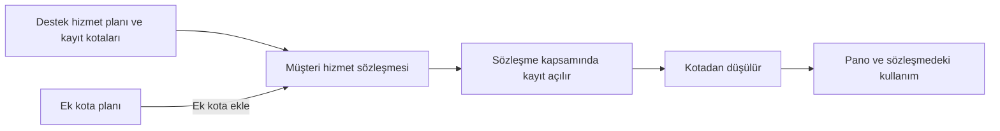

Hizmet planı, müşterilerinize sunduğunuz destek paketinin tanımıdır. Planda paketin adı ve ticari koşulları, en önemlisi de **kayıt kotaları** yer alır. Kayıt kotası, müşterinin sözleşmesi boyunca kaç olay, hizmet talebi ya da iş günlüğü açabileceğini belirler. Plan bir müşteri hizmet sözleşmesine bağlandığında, o sözleşme kapsamında açılan kayıtlar kotadan kendiliğinden düşülür. Kotanın ne kadarının tüketildiğini hem sözleşmede hem bu ekranın panosunda izlersiniz.

## Ekrana ulaşma

Hizmet planları yönetim ayarlarındadır. `Ayarlar` sayfasını açın (bkz. [Başlangıç](/docs/yonetici/baslangic)), ardından `Hizmet İlişkileri Yönetimi` bölümündeki `Hizmet Planları` kartına tıklayın.

| # | Öğe | Ne işe yarar |
|---|---|---|
| ❶ | **Hizmet İlişkileri Yönetimi** | Müşteriler, müşteri hizmet sözleşmeleri ve hizmet planlarının bulunduğu ayar bölümü. |
| ❷ | `Hizmet Planları` | Bu ekranı açar. |

Ekran, sözleşme detayından da açılabilir. Sözleşmenin `Hizmet Planı Kullanımı` sekmesinde plan adına tıklarsanız o plan, düzenleme penceresi açık olarak gelir (bkz. [Sözleşmede Plan Kullanımı](/docs/yonetici/hizmet-planlari/sozlesmede-kullanim)).

## Temel kavramlar

| Kavram | Anlamı |
|---|---|
| **Destek hizmet planı** | Müşteriye sunulan destek paketi. |
| **Kayıt kotası** | Planın kayıt tipi başına verdiği hak, ör. 60 olay. |
| **Sözleşme** | Planı müşteriye bağlar; kota sözleşme başına tutulur. |
| **Tüketim** | Kayıt açılınca kotadan düşülen miktar: 1 ya da `Efor` değeri. |
| **Ek kota planı** | Kotayı yükselten hazır paket, ör. +10 olay. |
| **Faturalandırma kuralı** | İş günlüklerini ücretlendiren, tüm sistemde geçerli kural. |

Plan `Destek Planı` sekmesinde oluşturulur ve müşteri hizmet sözleşmesindeki `Destek Planı` alanından seçilir. Kotalar [Kayıt Kotaları](/docs/yonetici/hizmet-planlari/kayit-kotalari), ek kota paketleri [Ek Kota Planları](/docs/yonetici/hizmet-planlari/ek-kota-planlari), kurallar [Faturalandırma Kuralları](/docs/yonetici/hizmet-planlari/faturalandirma-kurallari) sayfasında anlatılır.

Planla kotanın ilişkisi kısaca şöyledir:

## Ekranın bölümleri

| # | Bölüm | Ne işe yarar |
|---|---|---|
| ❶ | `Pano` | Kota sağlığı ve kota analizi raporları. |
| ❷ | `Destek Planı` | Hizmet planı listesi ve plan formu. |
| ❸ | `Ek Kota Planı` | Ek kota paketleri. |
| ❹ | **Faturalandırma Kuralı** | İş günlüğü ücret kuralları. |
| ❺ | `Ara`, `Grid Görünümü` | Genel arama ve `Genel Grid Görünümü`. |

Ekran her açılışta `Pano` sekmesiyle başlar (bkz. [Pano](/docs/yonetici/hizmet-planlari/pano), [Destek Planları](/docs/yonetici/hizmet-planlari/destek-planlari)). ❺'teki simgeler bu modüle özgü değildir; diğer ekranlarda da aynı yerde bulunur.

## Kimler kullanabilir

Ekranı açmak için rolünüzde `Servis Planlarını Yönetebilir` yetkisi olmalıdır. Bu yetki rol düzenleme ekranındaki yönetici yetkileri arasındadır. Ekleme, düzenleme ve silme ayrı yetkilere bölünmemiştir: Yetkisi olan kullanıcı planları, ek kota planlarını ve kuralları görebilir, ekleyebilir, düzenleyebilir ve silebilir. Sözleşmedeki `Hizmet Planı Kullanımı` sekmesi de aynı yetkiyi ister.

<Callout type="info" title="ÖNEMLİ">
Bu belge ekranın yeni (React) sürümünü anlatır. `Genel Ayarlar` sayfasındaki **Servis Planı sayfasını React (V2) olarak aç** ayarı kapatılırsa eski ekran açılır. Eski ekranda yalnızca plan listesi vardır; pano, kayıt kotaları, ek kota planları ve faturalandırma kuralları bulunmaz.
</Callout>

## Diğer modüllerle bağlantı

- **Müşteri hizmet sözleşmeleri:** Plan, sözleşmenin `Destek Planı` alanında seçilir. Bu alan yalnızca müşteri hizmet sözleşmelerinde görünür (bkz. [Sözleşme Detayı](/docs/teknisyen/moduller/sozlesmeler/detay)). Kota kullanımı, ek kota ve plan devri sözleşmenin `Hizmet Planı Kullanımı` sekmesindedir.
- **Olaylar ve hizmet talepleri:** Sözleşme kapsamında açılan olay ve hizmet talepleri, bunlara bağlı görevler ve iş günlükleri kotadan düşülür. Bkz. [Kayıt Kotaları](/docs/yonetici/hizmet-planlari/kayit-kotalari#kota-nasıl-düşülür).
- **İş günlükleri:** Faturalandırma kuralları, kaydedilen iş günlüklerini ücretlendirir. Hesaplanan tutarlar sözleşmenin `Ücretlendirme` bölümünde görünür.
