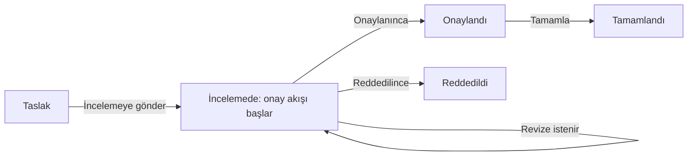

Bir veri setine aşama tanımlayarak kayıtların izleyeceği iş akışını belirlersiniz (ör. Taslak → İncelemede → Onaylandı → Tamamlandı). Aşamalar veri setinin `Aşamalar ve onay` sekmesinde tasarlanır.

## Aşama diyagramı

| # | Öğe | Ne işe yarar |
|---|---|---|
| ❶ | Aşama alanı | Aşamaları üreten **Tek seçim** alanı; alanın her seçeneği bir aşamadır. Veri setinde tek seçimli alan yoksa önce bir tane ekleyin. |
| ❷ | Başlangıç aşaması | `Başlangıç` etiketli aşama; yeni kayıt burada açılır. |
| ❸ | Onay aşaması | `Onay akışı` etiketli aşama; `Revizede kalır` revize istenince kaydın bu aşamada kaldığını gösterir. |
| ❹ | **Yeni aşamanın adı**, `Aşama ekle` | Yeni aşama ekler. |

- **Geçiş eklemek:** Bir aşamanın sağındaki noktadan başka bir aşamaya sürükleyin.
- **Geçiş silmek:** Geçişi seçip Delete'e basın.
- Aşamaların üzerindeki etiketler: `Başlangıç`, `Son aşama`, `Onay akışı`, `Revizede kalır`.
- Bir aşamaya tıklayınca ayarları sağ panelde açılır.

## Aşama ayarları

| # | Öğe | Ne işe yarar |
|---|---|---|
| ❶ | **Adı** | Aşamanın görünen adı. Altındaki **Renk** listede ve panoda kullanılır. |
| ❷ | `Yeni kayıt bu aşamada açılır`, `Son aşama` | Başlangıç aşaması; son aşamadan çıkılmaz. Onay aşaması son aşama olamaz. |
| ❸ | **Onay aşamaları** | Bu aşamaya bağlı onay akışı ve sonucunda kaydın taşınacağı aşamalar (aşağıda). |

Panelin altında **Bu aşamadan geçişler** (bu aşamadan gidilebilecek aşamalar; `Geçiş ekle` ile eklenir) ve `Aşamayı kaldır` bulunur. Aşama kaldırılınca aşama alanının bu seçeneği de kaldırılır, geçişleri düşer; kayıtlı değerler değişmez.

## Geçiş kuralları

- **Hiç geçiş tanımlanmamışsa** kayıt aşamalar arasında serbestçe geçer (son aşamadan çıkılmaz) ve aşama alanı formda düzenlenebilir.
- **Geçiş tanımlanmışsa** kayıt yalnız tanımlı geçişlerle ilerler. Aşama alanı formda salt okunurdur; aşama kayıt detayındaki düğmelerle değişir. Yeni kayıt yalnız başlangıç aşamasında açılır.

Her geçişin ayarları, kaynak aşamanın panelinde geçişin altında durur:

| # | Öğe | Ne işe yarar |
|---|---|---|
| ❶ | Düğme adı | Kayıt detayındaki düğmenin yazısı (ör. "İncelemeye gönder"). Boşsa hedef aşamanın adı yazar. |
| ❷ | **Geçişte zorunlu alanlar** | Geçiş anında doldurulması gereken alanlar (en çok 20). Aşama alanı, hesaplanan ve hassas alan seçilemez. |
| ❸ | `Gerekçe iste` | Kullanıcıdan gerekçe istenir (en çok 1000 karakter); gerekçe kayıt geçmişine yazılır. |
| ❹ | **Onay iletisi (isteğe bağlı)** | Geçişten önce gösterilen uyarı metni. |

Kurallar ekranda, API'de ve sunucu betiklerinde aynı şekilde uygulanır. Tanımsız bir geçiş denenirse: "Kayıt bu aşamaya geçirilemez: bulunduğu aşamadan bu aşamaya geçiş tanımlı değil."

Kullanıcı tarafında geçiş düğmeleri kayıt detayındaki aşama çubuğunun altında görünür (Düzenle yetkisiyle). Kuralı olan geçişte bir pencere açılır; boş zorunlu alanlar ve gerekçe burada sorulur. Panoda kartı sürüklemek de aynı kurallarla çalışır.

## Onay akışı bağlama

Özel modüller ServiceCore'un **gelişmiş onay akışı** motorunu kullanır. Ayrı bir "onaya gönder" düğmesi yoktur: Kayıt, onay akışı bağlanmış aşamaya girdiğinde akış başlar.

1. `Yönetim ▸ Onay Akışları` ekranında modül tipi olarak **Özel Modül** seçerek bir akış tasarlayın. Akışın koşullarında yayındaki veri seti alanları kullanılabilir (hassas alanlar hariç).
2. Stüdyo'da onay yapılacak aşamayı seçin ve **Onay aşamaları** bölümünde **Onay akışı**, **Onaylanınca** ve **Reddedilince** aşamalarını seçin (yukarıdaki aşama ayarları görseli ❸).
3. Taslağı kaydedip yayına gönderin.

Şema yalnız örnek modülün ana yolunu gösterir; iptal gibi diğer geçişler diyagramdadır.

Davranış:

- Akış sürerken kaydın aşaması değiştirilemez ("Kaydın onay akışı sürüyor; aşama akış bitince değişir.").
- Onaycı revize isterse kayıt onay aşamasında kalır; düzenleme yetkisi olan kullanıcı kaydı düzeltip **Tekrar Onaya Gönder**'e basar.
- Akış başlatılamazsa kayıt yine yazılır. Kayıt silinince açık akış iptal edilir.
- Bağlı akış arşivlenemez; arşivdeki ya da "Özel Modül" tipinde olmayan bir akış yayını engeller.
- Özel modül akışlarında aksiyon olarak e-posta, HTTP isteği ve **Veri kaynağını çağır** kullanılabilir.

## Kullanıcı tarafında onay

Kayıt detayındaki `Onay` sekmesi akışın diyagramını ve zaman çizelgesini gösterir; sırası gelen onaycı burada karar verir (bkz. [Kayıt ekranları](/docs/yonetici/ozel-moduller/kayit-ekranlari#onay-sekmesi)).

- Bekleyen onaylar **Onaylarım** ekranındaki **Özel modüller** sekmesinde de listelenir.
- Onaycıya "Onayınız bekleniyor", kaydı oluşturana "Düzeltme istendi" ve "Onay süreci tamamlandı" e-postaları gider.
- Kaydı normalde göremeyen (kapsamı dışında kalan) onaycı, adım onu beklerken kaydı, geçmişini, dosyalarını ve onay panelini **salt okunur** görür. Kayıt onun listesinde görünmez ve onu değiştiremez.
