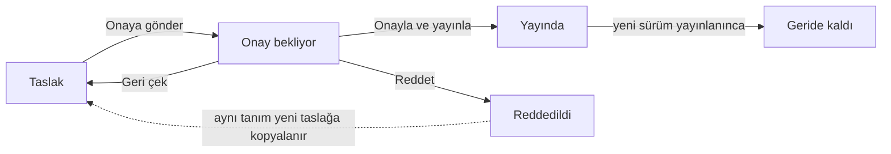

Stüdyo'da yapılan her değişiklik önce bir **taslağa** yazılır. Taslak, ikinci bir yetkilinin onayıyla **yayınlanır**; yeni sürüm o anda kullanıma açılır ve gerekli veritabanı değişiklikleri uygulanır.

## Sürüm durumları

| Durum | Anlamı |
|---|---|
| **Taslak** | Üzerinde çalışılan sürüm. |
| **Onay bekliyor** | Onaya gönderildi, düzenlenemez. |
| **Yayında** | Kullanıcıların kullandığı sürüm. |
| **Geride kaldı** | Önceki yayın. |
| **Reddedildi** | Onaycının reddettiği sürüm (notuyla iz olarak kalır). |

Yayındaki bir modülde ilk kaydetme yeni bir taslak açar; yayındaki sürüm taslak onaylanana kadar değişmez.

## Yayın akışı

1. Tasarımcı `Yayına gönder`'e basar; **Yayın** çekmecesi açılır (görsel ve alanları: [İlk modülünüzü oluşturun ▸ Onaya gönderin](/docs/yonetici/ozel-moduller/baslangic#6-onaya-gönderin)).
2. Çekmecede değişiklikleri inceler ve `Onaya gönder`'e basar. Düğme şu durumlarda kapalıdır: taslak kaydedilmemişse, taslakta sorun varsa ya da değişiklik veritabanında yapılamıyorsa.
3. Taslak **Onay bekliyor** olur ve kilitlenir. Tasarımcı `Geri çek` ile taslağı yeniden düzenlenebilir yapabilir.
4. Yayın izni olan **başka** bir kişi çekmecede `Onayla ve yayınla` ya da `Reddet` der.

<Callout type="warn" title="DİKKAT">
**Dört göz kuralı** kapatılamaz ve süper yöneticiyi de kapsar: Taslağı onaya gönderen kişi onaylayamaz. Onaya gönderildiğinde onaycıya bildirim gitmez; bekleyen taslak modül listesinde **Onay bekliyor** etiketiyle görünür. Reddetmek için not zorunludur; gönderen kişi de reddedebilir.
</Callout>

### Çekmecede incelenenler

- **Tanım değişiklikleri:** Eklendi / Kaldırıldı / Değişti; öğe ve değişen özellikler.
- **Dosya değişiklikleri:** Modül dosyalarının satır satır farkı. Kod bileşenlerinde derlenmiş çıktının kaynakla eşleştiği denetlenir. Kod değiştiyse çekmece uyarır: kod sayfayı açan kullanıcının yetkisiyle çalışır, onaylamadan önce kaynağı inceleyin.
- **SQL betiği:** Yayında çalışacak veritabanı betiği; kopyalama ve indirme düğmeleriyle.

Onaylanınca sunucu planı yeniden hesaplar; plan gönderimden sonra değiştiyse yayın durur ve taslağı geri çekip yeniden göndermeniz istenir. Değişiklikler tek işlemde uygulanır; bir hata olursa hiçbir değişiklik uygulanmaz.

### Ret sonrası

Reddedilen sürüm notuyla kalır, aynı tanım yeni numaralı bir taslağa kopyalanır. Taslakta son ret, inceleyen ve tarihiyle notu görünür; tasarımcı düzeltip yeniden gönderir.

## Sürümler

Üst çubuktaki `Sürümler` bütün sürümleri listeler.

| # | Öğe | Ne işe yarar |
|---|---|---|
| ❶ | `Durum` | Sürümün durumu; tabloda ayrıca oluşturan, gönderen, inceleyen ve not yazar. |
| ❷ | Taslak oluştur simgesi | **Bu sürümden taslak oluştur**: eski sürümün tanımını yeni bir taslağa kopyalar. |

Geri dönüş her zaman ileriye doğrudur: Eski sürüm yeni bir taslak olarak gelir ve yeniden onaydan geçer. Açık taslak varken eski sürüm kopyalanamaz.

## Dışa aktarma

Stüdyo'da `Diğer işlemler ▸ Dışa aktar` modülü `<anahtar>-v<N>.scmodule` dosyası olarak indirir.

- Yayındaki sürüm aktarılır; modül hiç yayınlanmadıysa taslak.
- Pakette: modül tanımı, rol yetkileri (rol adıyla, kapsamlarıyla) ve bağlı onay akışları.
- Pakette **olmayanlar:** kayıtlar, ekler, sırlar ve Custom Endpoint'ler.
- Belirli kişi, grup ya da kayıt değeri seçen onay akışları başka ortama taşınamaz.

## İçe aktarma

Modül listesinde `İçe aktar` başka bir ortamdan dışa aktarılan paketi yükler.

| # | Öğe | Ne işe yarar |
|---|---|---|
| ❶ | Yükleme alanı | `.scmodule` paketi sürüklenir ya da seçilir. |
| ❷ | `Rol yetkilerini de aktar` | Yetkiler rol adıyla eşlenir. |
| ❸ | `İçe aktar` | Paketi yükler; dosya seçilmeden kapalıdır. |

- Paket bu ortamda **taslak** olarak açılır; yayın bu ortamın dört göz onayından geçer. Modül burada zaten varsa yeni taslak açılır.
- Sonuçta hangi rollerin eşlendiği, hangilerinin bu ortamda bulunmadığı ve hangi onay akışlarının açıldığı listelenir.
- Paket değiştirilmişse, aynı anahtarlı ama başka bir modülden türemiş bir modül varsa ya da modülde açık taslak varsa içe aktarma reddedilir.
- İçe aktarmadan sonra Stüdyo, yayın çekmecesi açık olarak açılır.
